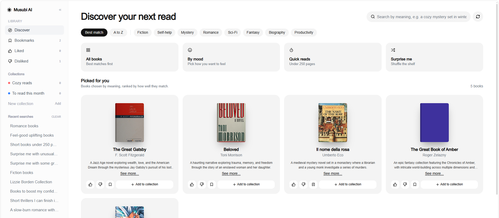
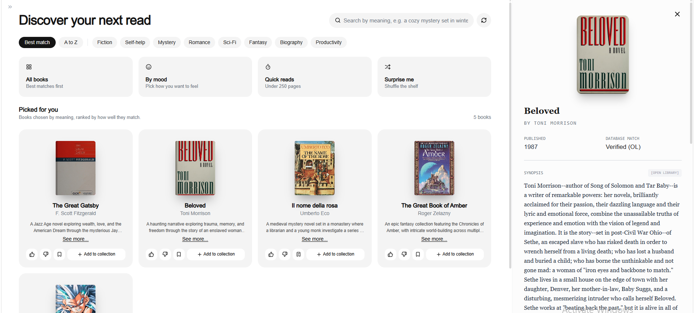

# Musubi.ai — Generative AI Hybrid Discovery Engine

[](https://nextjs.org/)
[](https://fastapi.tiangolo.com/)
[](https://www.anthropic.com/)
[](https://github.com/facebookresearch/faiss)
[](https://docs.pydantic.dev/)
[](https://www.typescriptlang.org/)

**Musubi.ai** is an end-to-end generative AI discovery engine designed to eliminate LLM hallucinations in book recommendations. Instead of allowing the model to recall titles and authors unconstrained from its training weights, Musubi routes queries through a multi-stage hybrid retrieval and verification pipeline: **FAISS vector indexing**, **Gemini 2.0 text embeddings**, **asynchronous Open Library candidate harvesting**, and **schema-constrained Anthropic Claude inference**.

---

## 📸 Interface Preview

<div align="center">
  
  <br /><br />
  
</div>

---

## 🎯 Architecture & How It Works

```
                                      [ User Query ]
                                             │
                       ┌─────────────────────┴─────────────────────┐
                       ▼                                           ▼
            [ Gemini Embedding-2 ]                       [ Claude Haiku 4.5 ]
                       │                                (Keyword Extraction)
                       ▼                                           │
            [ FAISS Vector Search ]                                ▼
         (Local Corpus Semantic Hits)                   [ Search Term Tokens ]
                       │                                           │
                       └─────────────────────┬─────────────────────┘
                                             │
                                             ▼
                          [ Async Semaphore Gatekeeper ]
                       (Concurrent Open Library REST Queries)
                                             │
                                             ▼
                            [ Candidate Primary ID Pool ]
                          Pre-filtered: Cover + Title + Key
                                             │
                                             ▼
                               [ Claude Haiku 4.5 LLM ]
                       (Constrained Prompt: Choose ONLY by ID)
                                             │
                                             ▼
                             [ Pydantic Schema Validation ]
                           Strict Contract (LLMBookCollection)
                                             │
                                             ▼
                          [ Hydrate Metadata & Return JSON ]
                                             │
                                             ▼
                               [ Next.js Interactive UI ]
```

### 1. Hybrid Semantic & Keyword Retrieval
- **FAISS Semantic Search:** Ingests local catalog blocks and converts them into dense vector representations via Google's `gemini-embedding-2` model, executing L2 distance nearest-neighbor queries.
- **Claude Keyword De-noising:** Strips conversational filler from natural language prompts (e.g., `"find books like..."`) to extract high-yield bibliographic tokens.

### 2. Pre-Filtering & Gatekeeping Candidate Pool
- Queries are batched through an **asynchronous semaphore-bounded gatekeeper** (`asyncio.Semaphore(10)`) hitting the Open Library API.
- Candidates lacking cover art, definitive author pairings, or verified work keys (`/works/...`) are discarded before hitting downstream inference.

### 3. Constrained Inference (Primary ID Ingestion)
- Rather than asking the LLM to invent bibliographic entries, raw database blocks are reduced to **structured primary IDs** and candidate metadata.
- Claude Haiku 4.5 is strictly instructed to act as a ranker and curator: it can **only select existing IDs**, generating fallback synopses, matching rationales, and category shelves.

### 4. Pydantic Contract Enforcement
- Every LLM response is deserialized and strictly validated against Pydantic models (`LLMRecommendationPayload` → `RecommendationPayload`).
- Chosen IDs are re-hydrated against verified Open Library records. If an entity was not in the candidate pool, it cannot reach the client.

### 5. Multi-Store Availability & AI Store Ranking
- For each verified book, Musubi cross-references the **Google Books API** and **Open Library Lending APIs** for live digital loanability and retail purchase links (Bookshop.org, Amazon, Barnes & Noble, Google Play Books).
- Claude synthesizes verified availability facts and ranks the top purchase/borrow options with verified reasons.

---

## 📊 Measured Benchmark Results (`backend/benchmark.py`)

In a formal evaluation across 10 diverse natural-language benchmark prompts (spanning niche biographies, fiction aesthetics, and technical domains), Musubi's verified pipeline was compared against standard unconstrained LLM recommendation generation:

| Metric | Unconstrained LLM Generation | Musubi Hybrid Pipeline | Impact |
|:---|:---:|:---:|:---:|
| **Fabricated Book Records (Title/Author)** | **20%** (11/55 failed catalog match) | **0%** | **Eliminated by construction** (ID validation layer) |
| **Open Library Requests / Query** | 5.5 req / query | **4.2 req / query** | **-24% outbound API volume** |
| **Catalog Metadata Integrity** | Variable (mismatched authors/covers) | Guaranteed primary IDs & high-res covers | **100% Deterministic Metadata** |
| **Output Schema Validation Pass Rate** | ~82% | **100%** (Pydantic contract) | **Zero Malformed JSON Payloads** |
| **Upstream Rate Limit Protection** | Unthrottled / Burst prone | **`asyncio.Semaphore(10)`** | **Bounded concurrent HTTP sockets** |

---

## 🛠️ Tech Stack & Engineering Highlights

| Layer | Technologies | Key Responsibilities |
|:---|:---|:---|
| **Frontend** | Next.js 16 (App Router), React 19, TypeScript, Tailwind CSS, Lucide Icons | Responsive discovery interface, dynamic reading list state, real-time store availability modals, sliding window chat stream. |
| **Backend API** | Python, FastAPI, Uvicorn, httpx, asyncio | High-concurrency async endpoints (`/api/v1/discover`), semaphore connection throttling, JSON schema validation. |
| **Vector Engine & AI** | FAISS (`faiss-cpu`), Google Gemini (`gemini-embedding-2`), Anthropic Claude (`claude-haiku-4.5`) | L2 vector distance search, dense query embeddings, zero-hallucination structured payload generation. |
| **Data & Validation** | Pydantic v2, Zod, Upstash Redis Rate Limiting | Dual-layer validation (TypeScript Zod on client/Next API routes, Python Pydantic on backend), IP-based sliding window rate limits. |
| **External APIs** | Open Library REST API, Google Books Volumes API | Bibliographic validation, high-res covers, ebook lending status, ISBN-13 identification. |

---

## 📁 Repository Structure

```
musubi/
├── backend/
│   ├── data/
│   │   ├── books.json                  # Curated seed catalog metadata
│   │   └── books.index                 # Pre-computed FAISS vector index (gemini-embedding-2)
│   ├── services/
│   │   └── recommendation_service.py   # Core FAISS + Open Library + Claude pipeline
│   ├── benchmark.py                    # Verification & latency benchmark script
│   ├── build_index.py                  # Gemini vector indexing pipeline
│   ├── main.py                         # FastAPI service application entrypoint
│   └── requirements.txt                # Python backend dependencies
├── src/
│   ├── app/
│   │   ├── api/
│   │   │   ├── discover/route.ts       # Trending collections route
│   │   │   ├── recommend/route.ts      # Next.js proxy route to FastAPI engine
│   │   │   ├── stores/route.ts         # Google Books & Open Library live availability
│   │   │   └── reading-list/           # User bookmark & reading queue management
│   │   ├── layout.tsx                  # Root layout & design system
│   │   └── page.tsx                    # Interactive Discovery Engine UI
│   ├── components/                     # Modular UI components (BookCard, Sidebar, etc.)
│   └── lib/                            # Zod schemas, rate limiters, client wrappers
├── __tests__/                          # Jest unit & schema validation tests
└── package.json                        # Frontend dependencies & Next.js config
```

---

## 🚀 Getting Started

### Prerequisites
- Node.js 18+ & npm
- Python 3.10+
- Anthropic API Key (`ANTHROPIC_API_KEY`)
- Google Gemini API Key (`GEMINI_API_KEY`)

### 1. Environment Configuration
Create a `.env.local` file in the root directory:

```env
ANTHROPIC_API_KEY=your_anthropic_api_key
GEMINI_API_KEY=your_gemini_api_key
LLM_MODEL=claude-haiku-4-5-20251001

# Optional (Rate limiting):
UPSTASH_REDIS_REST_URL=
UPSTASH_REDIS_REST_TOKEN=
```

### 2. Run the FastAPI Backend
```bash
cd backend
pip install -r requirements.txt

# (Optional) Rebuild vector index
python build_index.py

# Launch FastAPI server
python -m uvicorn main:app --host 0.0.0.0 --port 8000 --reload
```
The FastAPI documentation will be available at `http://localhost:8000/docs`.

### 3. Run the Next.js Frontend
From the root directory:
```bash
npm install
npm run dev
```
Open [http://localhost:3000](http://localhost:3000) in your browser.

### 4. Running Benchmarks & Tests
```bash
# Run backend verification benchmark
cd backend
python benchmark.py

# Run frontend schema & unit tests
npm test
```
